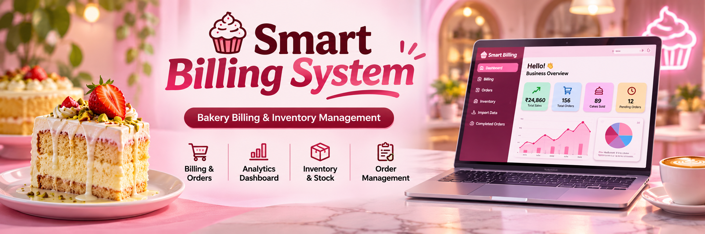

<div align="center">



</div>

# 🍰 Smart Billing System

A modern, bakery-focused billing and inventory management system designed to simplify daily business operations, manage orders, track product stock, and monitor business performance through an interactive analytics dashboard.

## 📌 Overview

**Smart Billing System** is a web-based billing application built for bakery and cake businesses. It provides an intuitive interface for managing products, processing customer orders, monitoring inventory, and analyzing sales performance.

The application combines an easy-to-use billing interface with a dedicated business analytics dashboard, helping business owners manage daily operations efficiently.

## ✨ Features

### 🧾 Billing & Order Management
- Interactive product catalog.
- Product selection and quantity management.
- Separate Dine-in and Take-away quantity controls.
- Automatic bill calculation.
- Order creation and saving.
- Payment mode management.
- Order management and tracking.

### 📊 Business Analytics Dashboard
- Total Sales overview.
- Total Orders tracking.
- Cakes Sold statistics.
- Pending Orders monitoring.
- Sales Overview charts.
- Top Selling Products analysis.
- Sales by Category visualization.
- Payment Summary.
- Order Status analytics.
- Recent Orders overview.

### 📅 Date Range Filtering
- Today
- Yesterday
- This Week
- This Month
- Custom Date Range

Dashboard metrics and visualizations respond to the selected reporting period.

### 📦 Inventory & Stock Management
- Real-time stock visibility.
- Automatic stock updates through order processing.
- Low Stock indicators.
- Out of Stock indicators.
- Product availability monitoring.

### 📁 Import Data
- Dedicated data import interface.
- Manage product data through the existing import workflow.

### 📋 Completed Orders
- Dedicated completed orders section.
- View previously processed orders.
- Review order and payment information.

## 🎨 UI & Design

- Modern bakery-inspired interface.
- Premium pink, berry, and peach gradient theme.
- Responsive dashboard layout.
- Clean product cards.
- Professional stock-status badges.
- Interactive charts and visualizations.
- Consistent navigation and styling.

## 🛠️ Technology Stack

| Technology | Purpose |
|---|---|
| HTML5 | Application structure |
| CSS3 | Styling and responsive UI |
| JavaScript | Application logic and interactions |
| Chart.js / Existing chart library | Analytics visualizations |

*The chart library entry should be adjusted to match the actual dependency used in the project.*

## 📂 Project Structure

```text
Smart-billing-system/
│
├── images/
│   ├── Product images
│   └── Other image assets
│
├── index.html
├── style.css
├── script.js
└── README.md
```

## 🚀 Getting Started

### 1. Clone the Repository

```bash
git clone https://github.com/autbruba22it007/Smart-billing-system.git
```

### 2. Navigate to the Project

```bash
cd Smart-billing-system
```

### 3. Run the Application

Open `index.html` in your browser.

For development, you can also use the **Live Server** extension in Visual Studio Code.

## 📸 Application Screenshots

Screenshots of the Billing Interface and Analytics Dashboard can be added here.

```markdown


```

## 🎯 Project Objective

The primary objective of this project is to simplify bakery billing operations while providing useful business insights through inventory tracking, order management, and sales analytics.

## 🔮 Future Enhancements

Potential future improvements include:

- Advanced sales reports.
- PDF invoice generation.
- Customer management.
- Automated receipt printing.
- Sales export functionality.
- Enhanced reporting and business insights.

## 👨‍💻 Author

**Isaac Bernods**

Full-Stack Developer

GitHub: [@autbruba22it007](https://github.com/autbruba22it007)

---

⭐ If you find this project useful, consider giving it a star!
